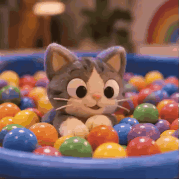

<div align="center">

<a href="https://apiko.app/zh/gpt-image-2-6-prompts?utm_source=github&utm_medium=banner&utm_campaign=awesome-gpt-image-2.6-prompts"></a>

[](LICENSE)
[](README_zh-CN.md#menu)
[](https://apiko.app/zh/models/gpt-image-2.6-flare?utm_source=github&utm_medium=badge&utm_campaign=awesome-gpt-image-2.6-prompts&utm_content=model_try)
[](https://apiko.app/zh/docs/api-manual/image-series/gpt-image-2.6-flare/images?utm_source=github&utm_medium=badge&utm_campaign=awesome-gpt-image-2.6-prompts&utm_content=docs)

[](README.md)
[](README_zh-CN.md)
[](README_zh-TW.md)
[](README_ko.md)

</div>

# Awesome GPT Image 2.6 提示词

<a id="introduction"></a>
## 🌟 简介

**GPT Image 2.6 提示词：319 条可直接复制的示例，附效果图，涵盖循环 GIF、表情包、圈选编辑、海报和商品图。**

每条 GPT Image 2.6 提示词都附上它生成的图片或 GIF：直接复制，或发送到试用台改几处细节再跑。 GIF 成品在 GitHub 页面上直接循环播放。

在线搜索和筛选： [apiko.app/gpt-image-2-6-prompts](https://apiko.app/zh/gpt-image-2-6-prompts?utm_source=github&utm_medium=readme&utm_campaign=awesome-gpt-image-2.6-prompts&utm_content=intro).

> [!NOTE]
> 提示词保持作者发布时的原文，所以大多是英文；标题和简介是我们写的。每条都署名作者并链接原帖。

<a id="quick-start"></a>
## 🚀 快速开始

**网页上用：** 每条都有「在 APIKO 运行」链接，会在 [apiko.app](https://apiko.app/zh/gpt-image-2-6-prompts?utm_source=github&utm_medium=quickstart&utm_campaign=awesome-gpt-image-2.6-prompts&utm_content=browser) 打开这条示例；点「使用」，提示词就会填进 GPT Image 2.6 试用台。

**用 API：** 先创建 [APIKO API Key](https://apiko.app/zh/dashboard/apikeys?utm_source=github&utm_medium=quickstart&utm_campaign=awesome-gpt-image-2.6-prompts&utm_content=api_key)，再创建异步任务并轮询，直到图片生成完成。

```bash
export APIKO_API_KEY="your_key_here"

TASK_ID=$(curl -s https://api.apiko.app/v1/images/generations \
  -H "Authorization: Bearer $APIKO_API_KEY" \
  -H "Content-Type: application/json" \
  -d '{
  "model": "gpt-image-2.6-flare",
  "prompt": "A minimalist poster of a paper boat on a calm lake at sunrise, the title \"Morning\" in bold serif type.",
  "size": "16:9",
  "resolution": "1k",
  "quality": "medium",
  "async": true
}' | python3 -c 'import json,sys; print(json.load(sys.stdin)["id"])')

# When status is "completed", the image is at data[0].url (kept for 24 hours).
while :; do
  TASK=$(curl -s https://api.apiko.app/v1/tasks/$TASK_ID \
    -H "Authorization: Bearer $APIKO_API_KEY")
  printf '%s\n' "$TASK"
  printf '%s' "$TASK" | grep -qE '"status": *"(completed|failed)"|"error": *\{' && break
  sleep 5
done
```

接口: `POST https://api.apiko.app/v1/images/generations` (创建任务) · `GET https://api.apiko.app/v1/tasks/{id}` (查询状态和结果)

<a id="how-to-write"></a>
## ✍️ GPT Image 2.6 提示词怎么写

这些提示词里反复出现的四种结构。

- **循环 GIF** · `主体 + 一个动作 + 回到起点 + 固定镜头` — GIF 提示词按顺序写一个动作，结尾回到起始姿势让循环接得上，并说明镜头不动。不少还会写明帧数。
- **圈选编辑** · `圈了什么 + 改成什么 + 其余不变` — 在要改的地方画圈，每个圈配一句简短指令。API 以同尺寸的透明叠加图接收这些标注。
- **同一角色出多张图** · `锁定特征 + 每张只换动作或场景` — 表情包和绘本提示词先列出要保留的发型、服装和配色，再只改动作、配字或场景。
- **摄影需求** · `主体 + 光线 + 镜头或胶片 + 质感` — 人像和商品提示词会写明光线（窗光、黄金时刻逆光）、镜头或胶片感，以及想看到的材质细节。

**从示例里能看到什么**

- **GIF 用短提示词就够。** 这里有好几条循环动图只写了一句话，比如“骑自行车的鹈鹕”。长一些的提示词会补上动作顺序和哪些部分保持不动。
- **把配字写进表情包。** 表情包提示词把文字放进引号并说明位置，一套不同情绪的表情就能共用一个角色。
- **可复用的提示词留出空位。** 模板类提示词用方括号标出要填的部分，比如 [object]、[Brand Name]，其余保持不变。
- **给上传的图编号。** 编辑类提示词会写“第二张图里的狗”“图 1”，让模型分清每张图提供什么。
- **一次只改一处。** 广告牌示例先生成场景，再只改天气，文字和版式就不容易跑偏。

<a id="menu"></a>
## 📑 目录

- [⭐ 精选](#featured) (6)
- [🔁 GIF 动图](prompts/gif-animation_zh-CN.md) (38) — 短循环动画：写一个动作，最后回到起始姿势，镜头保持不动。
- [🧩 角色与表情包](prompts/characters-stickers_zh-CN.md) (12) — 表情包、动作帧和角色设定图，每一格都是同一个角色。
- [✏️ 图片编辑与圈选](prompts/image-editing_zh-CN.md) (14) — 只改上传图片里的一处，常用圆圈标出位置，其余保持不变。
- [🔤 海报与文字排版](prompts/posters-typography_zh-CN.md) (31) — 海报、贺卡、广告牌和 Logo，画面里的文字要一字不差。
- [📷 人像与摄影](prompts/portrait-photography_zh-CN.md) (34) — 按拍摄需求写人物：镜头、光线、景别，以及皮肤或衣料的质感。
- [🎨 插画与 3D](prompts/illustration-3d_zh-CN.md) (57) — 绘本、漫画分格、纸雕场景、黏土胸像和材质习作。
- [📊 信息图与界面](prompts/infographics-ui_zh-CN.md) (24) — 图解、时间线、菜谱卡、幻灯片和 App 界面，标签都写明。
- [🍱 商品与美食](prompts/product-food_zh-CN.md) (52) — 瓶子、包装和菜品，按商业拍摄的方式打光。
- [🏙️ 空间与风景](prompts/scenes-places_zh-CN.md) (57) — 室内、建筑、街道和自然风景，每张只配一种光线和一种镜头。
- [❓ 常见问题](#faq)
- [🔗 相关链接](#related)

<a id="featured"></a>
## ⭐ 精选

<a id="gif-animation-01"></a>
### 1. 雪林提灯小猴循环动图

作者 [@OpenAI](https://developers.openai.com/api/docs/guides/image-prompting?model=gpt-image-2.6#generate-a-looping-gif) · 2 秒 · 1:1 · **[▶ 在 APIKO 运行](https://apiko.app/zh/gpt-image-2-6-prompts?utm_source=github&utm_medium=case&utm_campaign=awesome-gpt-image-2.6-prompts&utm_content=gif-animation-01#gif-animation-01)** · [原帖](https://developers.openai.com/api/docs/guides/image-prompting?model=gpt-image-2.6#generate-a-looping-gif)

<a href="https://apiko.app/zh/gpt-image-2-6-prompts?utm_source=github&utm_medium=case&utm_campaign=awesome-gpt-image-2.6-prompts&utm_content=gif-animation-01#gif-animation-01"></a>

**提示词:**

```text
A little monkey in an olive-green hooded coat stands in a snowy pine forest at dusk. A wooden cabin glows in the background. The monkey holds a glowing amber paper lantern at chest height, slowly lifts it, looks up and blinks, then lowers it back to its starting pose. Keep the lantern in its hands and the camera still. Make the motion loop smoothly.
```

<a id="gif-animation-32"></a>
### 30. 纽约雪景水晶球

作者 [@dreamwieber](https://x.com/dreamwieber) · 1 秒 · 1:1 · **[▶ 在 APIKO 运行](https://apiko.app/zh/gpt-image-2-6-prompts?utm_source=github&utm_medium=case&utm_campaign=awesome-gpt-image-2.6-prompts&utm_content=gif-animation-32#gif-animation-32)** · [原帖](https://x.com/dreamwieber/status/2118190877567037732)

<a href="https://apiko.app/zh/gpt-image-2-6-prompts?utm_source=github&utm_medium=case&utm_campaign=awesome-gpt-image-2.6-prompts&utm_content=gif-animation-32#gif-animation-32"></a>

**提示词:**

```text
generate an animated gif of a beautiful NYC snow globe
```

<a id="gif-animation-15"></a>
### 15. 黏土小猫玩海洋球

作者 [@dreamwieber](https://x.com/dreamwieber) · 1 秒 · 1:1 · **[▶ 在 APIKO 运行](https://apiko.app/zh/gpt-image-2-6-prompts?utm_source=github&utm_medium=case&utm_campaign=awesome-gpt-image-2.6-prompts&utm_content=gif-animation-15#gif-animation-15)** · [原帖](https://x.com/dreamwieber/status/2118191599872344467)

<a href="https://apiko.app/zh/gpt-image-2-6-prompts?utm_source=github&utm_medium=case&utm_campaign=awesome-gpt-image-2.6-prompts&utm_content=gif-animation-15#gif-animation-15"></a>

**提示词:**

```text
generate an animated gif of a claymation kitten playing in a plastic ball pit
```

<a id="gif-animation-14"></a>
### 14. 骑自行车的鹈鹕

作者 [@SSHCodes](https://x.com/SSHCodes) · 1 秒 · 1:1 · **[▶ 在 APIKO 运行](https://apiko.app/zh/gpt-image-2-6-prompts?utm_source=github&utm_medium=case&utm_campaign=awesome-gpt-image-2.6-prompts&utm_content=gif-animation-14#gif-animation-14)** · [原帖](https://x.com/SSHCodes/status/2118127375481504100)

<a href="https://apiko.app/zh/gpt-image-2-6-prompts?utm_source=github&utm_medium=case&utm_campaign=awesome-gpt-image-2.6-prompts&utm_content=gif-animation-14#gif-animation-14"></a>

**提示词:**

```text
generate a gif of a pelican riding a bicycle
```

<a id="gif-animation-27"></a>
### 25. 冲咖啡的机器人

作者 [@sousoccer6](https://x.com/sousoccer6) · 2 秒 · 1:1 · **[▶ 在 APIKO 运行](https://apiko.app/zh/gpt-image-2-6-prompts?utm_source=github&utm_medium=case&utm_campaign=awesome-gpt-image-2.6-prompts&utm_content=gif-animation-27#gif-animation-27)** · [原帖](https://x.com/sousoccer6/status/2118210705585537226)

<a href="https://apiko.app/zh/gpt-image-2-6-prompts?utm_source=github&utm_medium=case&utm_campaign=awesome-gpt-image-2.6-prompts&utm_content=gif-animation-27#gif-animation-27"></a>

**提示词:**

```text
コーヒーを淹れるロボット
```

<a id="gif-animation-33"></a>
### 31. 拉各斯街头跳非洲节拍舞的机器人

作者 [@o_adeeko](https://x.com/o_adeeko) · 1 秒 · 1:1 · **[▶ 在 APIKO 运行](https://apiko.app/zh/gpt-image-2-6-prompts?utm_source=github&utm_medium=case&utm_campaign=awesome-gpt-image-2.6-prompts&utm_content=gif-animation-33#gif-animation-33)** · [原帖](https://x.com/o_adeeko/status/2118203950306410729)

<a href="https://apiko.app/zh/gpt-image-2-6-prompts?utm_source=github&utm_medium=case&utm_campaign=awesome-gpt-image-2.6-prompts&utm_content=gif-animation-33#gif-animation-33"></a>

**提示词:**

```text
Create an animated GIF of a robot dancing to Afrobeats on a busy Lagos street. Make the movement loop smoothly.
```

- **[🔁 查看「GIF 动图」全部 38 条](prompts/gif-animation_zh-CN.md)**
- **[🧩 查看「角色与表情包」全部 12 条](prompts/characters-stickers_zh-CN.md)**
- **[✏️ 查看「图片编辑与圈选」全部 14 条](prompts/image-editing_zh-CN.md)**
- **[🔤 查看「海报与文字排版」全部 31 条](prompts/posters-typography_zh-CN.md)**
- **[📷 查看「人像与摄影」全部 34 条](prompts/portrait-photography_zh-CN.md)**
- **[🎨 查看「插画与 3D」全部 57 条](prompts/illustration-3d_zh-CN.md)**
- **[📊 查看「信息图与界面」全部 24 条](prompts/infographics-ui_zh-CN.md)**
- **[🍱 查看「商品与美食」全部 52 条](prompts/product-food_zh-CN.md)**
- **[🏙️ 查看「空间与风景」全部 57 条](prompts/scenes-places_zh-CN.md)**

<a id="faq"></a>
## ❓ 常见问题

<details>
<summary><b>这些 GPT Image 2.6 提示词可以免费使用吗？</b></summary>

提示词可以随意复制、修改和运行。提示词和效果归卡片标注的创作者所有，想把效果图用于商业用途，请先看原帖。

</details>

<details>
<summary><b>怎样用 GPT Image 2.6 生成 GIF？</b></summary>

把提示词发到 POST /v1/images/generations，output_format 设为 gif。frame_count 可设 2 到 16 帧（默认 9），frame_duration_ms 每帧 20 到 2000 毫秒（默认 200）；编辑接口不支持 GIF。

</details>

<details>
<summary><b>GPT Image 2.6 的 GIF 是多大尺寸？</b></summary>

output_format 为 gif 时，size 指单帧的宽高，auto 为 512x512。所有帧画在同一张图上，所以单帧越大可用帧数越少：512x512 最多 16 帧，768x768 最多 12 帧。

</details>

<details>
<summary><b>API 里的圈选编辑怎么用？</b></summary>

调用 POST /v1/images/edits，传入原图和 markup：一张与原图同尺寸、画好圆圈或标注的透明 PNG。markup 不能和 mask 同时使用。

</details>

<details>
<summary><b>GPT Image 2.6 的 complexity 参数是什么？</b></summary>

complexity 决定模型动笔前规划多少，可选 low、medium、high，默认 high。它独立于 quality，也不单独计费；局部编辑适合 low，文字密集或版式复杂时用 high。

</details>

<details>
<summary><b>选 gpt-image-2.6-flare 还是 gpt-image-2.6-sunburst？</b></summary>

先用 Flare，适合快速迭代、海报和商品图。需要更多细节，或在 medium、high 质量下反复编辑仍要保持一致时，换 Sunburst。

</details>

<details>
<summary><b>GPT Image 2.6 最多能传几张参考图？</b></summary>

1 到 16 个 HTTPS 图片链接。本地文件需要先用 POST /v1/uploads/images 上传。

</details>

<details>
<summary><b>提示词用什么语言写？</b></summary>

这里的提示词保持作者原文，有中文、日文和英文，没有翻译。可以直接复制，也可以改写成你习惯的语言。

</details>

<details>
<summary><b>GPT Image 2.6 怎么计费？</b></summary>

按每次结果用掉的 token 计费。质量档位越高、GIF 帧数越多，用的 token 越多；当前价格见模型页。

</details>

<details>
<summary><b>为什么我跑出来的效果和卡片不一样？</b></summary>

图像模型的结果不是固定的，同一条提示词每次都会不同。作者也可能用了参考图、其他参数或 ChatGPT 应用。

</details>


<a id="related"></a>
## 🔗 相关链接

- [GPT Image 2.6 提示词 · apiko.app](https://apiko.app/zh/gpt-image-2-6-prompts?utm_source=github&utm_medium=related&utm_campaign=awesome-gpt-image-2.6-prompts)
- [GPT Image 2.6 Flare](https://apiko.app/zh/models/gpt-image-2.6-flare?utm_source=github&utm_medium=related&utm_campaign=awesome-gpt-image-2.6-prompts)
- [GPT Image 2.6 Sunburst](https://apiko.app/zh/models/gpt-image-2.6-sunburst?utm_source=github&utm_medium=related&utm_campaign=awesome-gpt-image-2.6-prompts)
- [GPT Image 2.5 提示词](https://apiko.app/zh/gpt-image-2-5-prompts?utm_source=github&utm_medium=related&utm_campaign=awesome-gpt-image-2.6-prompts)
- [GPT Image 2 提示词](https://apiko.app/zh/gpt-image-2-prompts?utm_source=github&utm_medium=related&utm_campaign=awesome-gpt-image-2.6-prompts)
- [AI 图片生成器](https://apiko.app/zh/image-generator?utm_source=github&utm_medium=related&utm_campaign=awesome-gpt-image-2.6-prompts)
- [APIKO API 代码示例](https://github.com/tong0619453646-dev/apiko-ai-api-examples)

**更多提示词合集**

- [Awesome Seedance 2.5 Prompts](https://github.com/tong0619453646-dev/awesome-seedance-2.5-prompts/blob/main/README_zh-CN.md)
- [Awesome Nano Banana 2.1 Prompts](https://github.com/tong0619453646-dev/awesome-nano-banana-2.1-prompts/blob/main/README_zh-CN.md)
- [Awesome GPT Image 2.5 Prompts](https://github.com/tong0619453646-dev/awesome-gpt-image-2.5-prompts/blob/main/README_zh-CN.md)
- [Awesome GPT Image 2 Prompts](https://github.com/tong0619453646-dev/awesome-gpt-image-2-prompts/blob/main/README_zh-CN.md)
- [Awesome Claude Opus 5.5 Video Prompts](https://github.com/tong0619453646-dev/awesome-claude-opus-5.5-video-prompts/blob/main/README_zh-CN.md)
- [Awesome Wan 3.0 Prompts](https://github.com/tong0619453646-dev/awesome-wan-3.0-prompts/blob/main/README_zh-CN.md)

<a id="license"></a>
## 📄 许可与出处

提示词和效果归每张卡片标注的创作者所有，卡片可跳转到原帖。署名 fujc683 的卡片来自 awesome-gpt-image-2-6-prompts 仓库，按 CC BY 4.0 许可使用。标题、简介、译文和生成脚本采用 [CC BY 4.0](LICENSE) 许可。来源仓库的许可证见 [THIRD_PARTY_NOTICES.md](THIRD_PARTY_NOTICES.md)。

如果这份合集帮你省了时间，点个 ⭐ 能让更多人看到。
