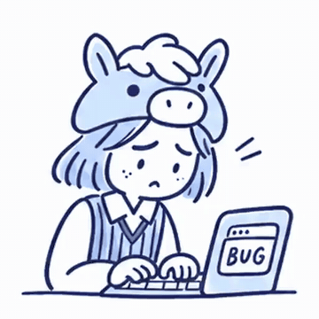
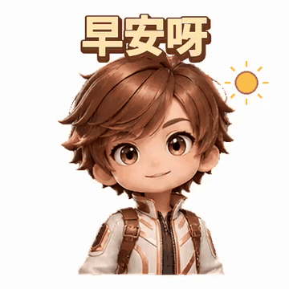
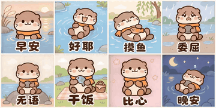
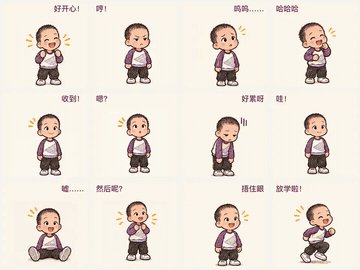

<div align="center">

<a href="https://apiko.app/zh/gpt-image-2-6-prompts?utm_source=github&utm_medium=banner&utm_campaign=awesome-gpt-image-2.6-prompts"></a>

[](../LICENSE)
[](../README_zh-CN.md#menu)
[](https://apiko.app/zh/models/gpt-image-2.6-flare?utm_source=github&utm_medium=badge&utm_campaign=awesome-gpt-image-2.6-prompts&utm_content=model_try)
[](https://apiko.app/zh/docs/api-manual/image-series/gpt-image-2.6-flare/images?utm_source=github&utm_medium=badge&utm_campaign=awesome-gpt-image-2.6-prompts&utm_content=docs)

[](characters-stickers.md)
[](characters-stickers_zh-CN.md)
[](characters-stickers_zh-TW.md)
[](characters-stickers_ko.md)

</div>

# 🧩 角色与表情包 · Awesome GPT Image 2.6 提示词

[← 返回 README](../README_zh-CN.md) · 本页共 12 条。提示词保持原文，未翻译。

> 表情包、动作帧和角色设定图，每一格都是同一个角色。

- [绘本森林小英雄：角色登场](#characters-stickers-01)
- [同一角色雪后救松鼠](#characters-stickers-02)
- [通用表情包模板：填梗即用](#characters-stickers-04)
- [同一角色两张动图：砸电脑、掉大肥鱼](#characters-stickers-06)
- [大肥鱼表情包模板](#characters-stickers-07)
- [参考角色眨眼（3×3 帧）](#characters-stickers-08)
- [用自己的角色做「收到」敬礼表情](#characters-stickers-10)
- [二次元角色三视图设定板](#characters-stickers-12)
- [小水獭表情包：从设定到动图](#characters-stickers-13)
- [一张图做 12 款动态表情](#characters-stickers-14)
- [橘猫打工人 12 宫格表情包](#characters-stickers-15)
- [火焰特效：关键帧扩成 12 帧](#characters-stickers-16)

<a id="characters-stickers-01"></a>
### 39. 绘本森林小英雄：角色登场

作者 [@OpenAI](https://developers.openai.com/api/docs/guides/image-prompting?model=gpt-image-2.6#keep-a-character-consistent) · 2:3 · **[▶ 在 APIKO 运行](https://apiko.app/zh/gpt-image-2-6-prompts?utm_source=github&utm_medium=case&utm_campaign=awesome-gpt-image-2.6-prompts&utm_content=characters-stickers-01#characters-stickers-01)** · [原帖](https://developers.openai.com/api/docs/guides/image-prompting?model=gpt-image-2.6#keep-a-character-consistent)

<table>
<tr><td align="center"><a href="https://apiko.app/zh/gpt-image-2-6-prompts?utm_source=github&utm_medium=case&utm_campaign=awesome-gpt-image-2.6-prompts&utm_content=characters-stickers-01#characters-stickers-01"></a></td><td align="center"><a href="https://apiko.app/zh/gpt-image-2-6-prompts?utm_source=github&utm_medium=case&utm_campaign=awesome-gpt-image-2.6-prompts&utm_content=characters-stickers-01#characters-stickers-01"></a></td></tr>
</table>

**提示词:**

```text
Create a children’s book illustration introducing a main character.

Character:
A young, storybook-style hero inspired by a little forest outlaw,
wearing a simple green hooded tunic, soft brown boots, and a small belt pouch.
The character has a kind expression, gentle eyes, and a brave but warm demeanor.
Carries a small wooden bow used only for helping, never harming.

Theme:
The character protects and rescues small forest animals like squirrels, birds, and rabbits.

Style:
Children’s book illustration, hand-painted watercolor look,
soft outlines, warm earthy colors, whimsical and friendly.
Proportions suitable for picture books (slightly oversized head, expressive face).

Constraints:
- Original character (no copyrighted characters)
- No text
- No watermarks
- Plain forest background to clearly showcase the character
```

<a id="characters-stickers-02"></a>
### 40. 同一角色雪后救松鼠

作者 [@OpenAI](https://developers.openai.com/api/docs/guides/image-prompting?model=gpt-image-2.6#keep-a-character-consistent) · 2:3 · **[▶ 在 APIKO 运行](https://apiko.app/zh/gpt-image-2-6-prompts?utm_source=github&utm_medium=case&utm_campaign=awesome-gpt-image-2.6-prompts&utm_content=characters-stickers-02#characters-stickers-02)** · [原帖](https://developers.openai.com/api/docs/guides/image-prompting?model=gpt-image-2.6#keep-a-character-consistent)

<table>
<tr><td align="center"><a href="https://apiko.app/zh/gpt-image-2-6-prompts?utm_source=github&utm_medium=case&utm_campaign=awesome-gpt-image-2.6-prompts&utm_content=characters-stickers-02#characters-stickers-02"></a></td><td align="center"><a href="https://apiko.app/zh/gpt-image-2-6-prompts?utm_source=github&utm_medium=case&utm_campaign=awesome-gpt-image-2.6-prompts&utm_content=characters-stickers-02#characters-stickers-02"></a></td></tr>
</table>

> 📎 这条需要你自己上传参考图。

**提示词:**

```text
Continue the children’s book story using the same character.

Scene:
The same young forest hero is gently helping a frightened squirrel
out of a fallen tree after a winter storm.
The character kneels beside the squirrel, offering reassurance.

Character Consistency:
- Same green hooded tunic
- Same facial features, proportions, and color palette
- Same gentle, heroic personality

Style:
Children’s book watercolor illustration,
soft lighting, snowy forest environment,
warm and comforting mood.

Constraints:
- Do not redesign the character
- No text
- No watermarks
```

<a id="characters-stickers-04"></a>
### 41. 通用表情包模板：填梗即用

作者 [@0xluffy_eth](https://x.com/0xluffy_eth) · 1:1 · **[▶ 在 APIKO 运行](https://apiko.app/zh/gpt-image-2-6-prompts?utm_source=github&utm_medium=case&utm_campaign=awesome-gpt-image-2.6-prompts&utm_content=characters-stickers-04#characters-stickers-04)** · [原帖](https://x.com/0xluffy_eth/status/2118235544459387112)

<a href="https://apiko.app/zh/gpt-image-2-6-prompts?utm_source=github&utm_medium=case&utm_campaign=awesome-gpt-image-2.6-prompts&utm_content=characters-stickers-04#characters-stickers-04"></a>

> 📎 这条需要你自己上传参考图。

**提示词:**

```text
请以我上传的角色图为参考，按「表情包主题」做一张可下载的动态 GIF。

【角色保持一致】锁发型/配色/标志道具，Q 版比例全帧不变
【自动设计动作】一个核心笑点，夸张一点，首尾能循环
【自动配字】2～8 个字网感短句，顶部粗圆体+白描边
【画面】正方形纯白底，2～3 秒循环，聊天表情包规格

表情包主题：【填你的梗，比如「周一不想上班」】
```

<a id="characters-stickers-06"></a>
### 42. 同一角色两张动图：砸电脑、掉大肥鱼

作者 [@Gimi_min](https://x.com/Gimi_min) · 6 秒 · 1:1 · **[▶ 在 APIKO 运行](https://apiko.app/zh/gpt-image-2-6-prompts?utm_source=github&utm_medium=case&utm_campaign=awesome-gpt-image-2.6-prompts&utm_content=characters-stickers-06#characters-stickers-06)** · [原帖](https://x.com/Gimi_min/status/2118243060064964703)

<a href="https://apiko.app/zh/gpt-image-2-6-prompts?utm_source=github&utm_medium=case&utm_campaign=awesome-gpt-image-2.6-prompts&utm_content=characters-stickers-06#characters-stickers-06"></a>

> 📎 这条需要你自己上传参考图。

**提示词:**

```text
参考图 2人物 IP 制作两张GIF， 风格调性 按图 1。 第一张：人物发现电脑 bug 解不完，气砸电脑。 第二张：人物抱在怀里「大肥鱼」，掉出来。
```

<a id="characters-stickers-07"></a>
### 43. 大肥鱼表情包模板

作者 [@op7418](https://x.com/op7418) · 3 秒 · 1:1 · **[▶ 在 APIKO 运行](https://apiko.app/zh/gpt-image-2-6-prompts?utm_source=github&utm_medium=case&utm_campaign=awesome-gpt-image-2.6-prompts&utm_content=characters-stickers-07#characters-stickers-07)** · [原帖](https://x.com/op7418/status/2118181775688241456)

<a href="https://apiko.app/zh/gpt-image-2-6-prompts?utm_source=github&utm_medium=case&utm_campaign=awesome-gpt-image-2.6-prompts&utm_content=characters-stickers-07#characters-stickers-07"></a>

> 📎 这条需要你自己上传参考图。

**提示词:**

```text
提示词在这里，参考图用这两张就行，注意最后需要你填写的部分。

请以我上传的大肥鱼图片为角色和画风参考，根据最后一行的「表情包主题」，直接制作一张可下载的动态 GIF 表情包。

【角色保持一致】
保留参考图中的蓝色渐变长发、呆毛、鲸鱼耳鳍、蓝色蝴蝶结、白色女仆头饰、蓝白女仆裙和大鲸鱼尾巴。
保持原图的大头小身体 Q 版比例、圆脸和可爱画风，人物外观在所有帧中保持一致。

【自动设计动作】
理解我想表达的情绪或梗，将它设计成一个简单、有趣、一眼能看懂的短动作。
突出一个核心笑点，用夸张表情、动作反差和轻微的压缩回弹增加喜感。头发、呆毛、耳鳍和尾巴自然跟随动作。
根据主题添加必要的少量道具，保持画面简洁。
主动设计首尾衔接，让动画能够自然循环播放。

【自动配字】
根据主题提炼一句简短、有网感的中文配字，优先控制在 2～8 个字。
如果主题中用引号指定了台词，直接使用该台词。
字幕放在顶部，使用粗圆体、深蓝字、白色描边；文字、字形和位置全程稳定，角色与道具不遮挡字幕。

【画面与输出】
正方形画面，纯白背景，固定镜头，主体居中并保留足够边距。
动画约 2～3 秒，无限循环，动作清晰，适合聊天时作为表情包发送。
最终交付实际会播放的多帧 GIF 文件，并提供下载。

表情包主题：【在这里填一句话，描述你想表达的梗、情绪或动作】
```

<a id="characters-stickers-08"></a>
### 44. 参考角色眨眼（3×3 帧）

作者 [@uzuyanurp](https://x.com/uzuyanurp) · 1 秒 · 3:2 · **[▶ 在 APIKO 运行](https://apiko.app/zh/gpt-image-2-6-prompts?utm_source=github&utm_medium=case&utm_campaign=awesome-gpt-image-2.6-prompts&utm_content=characters-stickers-08#characters-stickers-08)** · [原帖](https://x.com/uzuyanurp/status/2118133109980041703)

<a href="https://apiko.app/zh/gpt-image-2-6-prompts?utm_source=github&utm_medium=case&utm_campaign=awesome-gpt-image-2.6-prompts&utm_content=characters-stickers-08#characters-stickers-08"></a>

> 📎 这条需要你自己上传参考图。

**提示词:**

```text
【参照画像からウインクGIFを作るプロンプト】

添付した参照画像のキャラクターを使って、短いループGIFアニメーションを生成してください。

■ キャラクター固定
・顔立ち、髪型、髪色、瞳、衣装、装飾を維持
・別人化や衣装変更をしない
・参照画像が設定資料の場合は、主となるキャラクターを使用

■ アニメーション
① 正面を見つめる通常表情
② 口元が少し緩む
③ 優しく微笑む
④ 片目を自然に閉じる
⑤ ウインクしながら笑顔
⑥ 片目を開き、元の表情へ戻る

■ 生成仕様
・9フレーム
・3×3の均等なスプライトシート
・1フレーム140ms
・約1.26秒のループGIF
・カメラ位置と背景は固定
・自然な瞬きと表情変化
・顔の輪郭や装飾のちらつきを抑える
・各フレームに文字や番号を入れない

■ 出力
完成したアニメーションGIFを出力してください。
静止画やプロンプトの提示だけで終わらないでください。
```

<a id="characters-stickers-10"></a>
### 45. 用自己的角色做「收到」敬礼表情

作者 [@derek_wall90176](https://x.com/derek_wall90176) · 3 秒 · 1:1 · **[▶ 在 APIKO 运行](https://apiko.app/zh/gpt-image-2-6-prompts?utm_source=github&utm_medium=case&utm_campaign=awesome-gpt-image-2.6-prompts&utm_content=characters-stickers-10#characters-stickers-10)** · [原帖](https://x.com/derek_wall90176/status/2118175241390436830)

<a href="https://apiko.app/zh/gpt-image-2-6-prompts?utm_source=github&utm_medium=case&utm_campaign=awesome-gpt-image-2.6-prompts&utm_content=characters-stickers-10#characters-stickers-10"></a>

> 📎 这条需要你自己上传参考图。

**提示词:**

```text
Using my uploaded image as the character reference, create a real, looping animated GIF sticker. Keep the character’s face, hairstyle, outfit, colors and art style consistent with the reference.

Use a square 1:1 composition, a transparent background, and a close-up that clearly shows the face and hands. Add the text ‘Got it!’ in bold, readable lettering at the top, keeping the text fixed throughout the animation.

The character starts with a smile, raises one hand in a salute, blinks happily, then lowers the hand and returns naturally to the starting pose. Keep the camera fixed and make the first and last frames flow smoothly into a loop.

Aim for around 16 frames and 2.5–3 seconds. Avoid flickering, sudden shape changes, extra limbs or camera cuts. Deliver a playable animated GIF, not a static image or a grid of frames.
```

<a id="characters-stickers-12"></a>
### 46. 二次元角色三视图设定板

作者 [@youci290897](https://x.com/youci290897) · 16:9 · **[▶ 在 APIKO 运行](https://apiko.app/zh/gpt-image-2-6-prompts?utm_source=github&utm_medium=case&utm_campaign=awesome-gpt-image-2.6-prompts&utm_content=characters-stickers-12#characters-stickers-12)** · [原帖](https://x.com/youci290897/status/2118931015490314403)

<a href="https://apiko.app/zh/gpt-image-2-6-prompts?utm_source=github&utm_medium=case&utm_campaign=awesome-gpt-image-2.6-prompts&utm_content=characters-stickers-12#characters-stickers-12"></a>

> 📎 这条需要你自己上传参考图。

**提示词:**

```text
生成一张16:9横向高清二次元动漫人物三视图设定板（Anime Character Reference Sheet）。

【人物外貌】

保留小巧鹅蛋脸、柔和圆润的脸颊、细小下巴、鲜红色眼睛、细致睫毛、轻微面颊红晕、小巧鼻子和淡淡的嘴唇。

人物神态安静、略带冷淡与慵懒感，目光柔和，保持原图独特的气质。

乌黑色齐颈短波波头，厚重齐刘海覆盖眉毛，刘海自然分束，发尾略微内扣，两侧有少量细碎发丝，头发带有原图同款明显而细腻的高光。

【服装——严格还原】

穿白色短袖运动T恤，深藏蓝色圆领与袖口包边，胸前带有小型深色植物状印花。

下身穿深藏蓝色松紧腰短运动裤，保留原图的运动布料质感、裤腰褶皱和裤脚剪裁。

腿部穿黑色罗纹长筒袜，保留袜子上的小型粉白色装饰图案。

【三视图排版结构】

采用横向16:9人物设定板布局。

左侧约40%为一张放大的动漫人物面部与上半身特写。

右侧约60%依次排列三张同一人物的完整全身图：正面、90度严格侧面、180度背面。

四个展示位置共享柔和的浅米灰色背景，画面干净整齐，无明显分割线、无文字、无编号、无水印。

【左侧：大型动漫面部特写】

放大展示角色的黑色短发、厚重齐刘海、鲜红色眼睛、微微泛红的脸颊和安静冷淡的表情。

人物头部略微倾斜，眼睛看向观众，保留原图精细的眼部绘制、睫毛、高光形状和柔和面部阴影。

展示白色运动T恤的领口、肩部和胸前部分服装。

【右侧第一位：正面全身视图】

人物正面站立，双肩放松，双臂自然垂放，双腿自然站立。

完整展示乌黑色短波波头、红色眼睛、白色深蓝包边运动T恤、深藏蓝色运动短裤和黑色长筒袜。

全身比例沿用原图二次元角色设定，头顶到脚部完整可见。

【右侧第二位：90度侧面全身视图】

同一个角色严格转身90度，展示完整侧脸、短发侧面轮廓、肩颈、手臂、躯干、短裤和腿部。

保留相同的五官结构、头身比例、服装剪裁与动漫上色风格。

禁止使用45度半侧面替代严格侧面。

【右侧第三位：180度背面全身视图】

同一角色完全背对观众，展示乌黑色短波波头背面、自然内扣的发尾、白色T恤背面、深蓝色领口和袖口、深藏蓝色运动短裤背面、黑色长筒袜。

背面发型长度、服装尺寸与身体比例和正面完全对应。

【绘画与光影】

高度还原参考图原本的精致日系二次元插画质感。

使用细腻干净的线条、柔和赛璐璐与半厚涂融合上色、自然渐变阴影、精致发丝高光、清晰红色虹膜、柔和皮肤高光、略带光泽的运动服材质。

色彩保持原图的黑色、白色、深藏蓝色、红色眼睛及淡粉色肌肤红晕。

整体画面细腻、柔和、清晰，人物面部与服装细节保持统一。

【强制一致性】

四个展示位置必须是同一角色，拥有完全一致的脸型、红色眼睛、黑色短发、厚重齐刘海、体型、服装和配色。

只允许改变人物观察角度与站姿，不改变角色设计及原始绘画风格。

禁止真人化、写实皮肤、3D建模、不同人物脸型、改变发型、改变瞳色、改变服装、额外人物、错误肢体、侧面角度错误、背面服装不一致、文字和水印。
```

<a id="characters-stickers-13"></a>
### 47. 小水獭表情包：从设定到动图

作者 [@AXIS95277](https://x.com/AXIS95277) · 2 秒 · 2:1 · **[▶ 在 APIKO 运行](https://apiko.app/zh/gpt-image-2-6-prompts?utm_source=github&utm_medium=case&utm_campaign=awesome-gpt-image-2.6-prompts&utm_content=characters-stickers-13#characters-stickers-13)** · [原帖](https://x.com/AXIS95277/status/2118320290065154405)

<a href="https://apiko.app/zh/gpt-image-2-6-prompts?utm_source=github&utm_medium=case&utm_campaign=awesome-gpt-image-2.6-prompts&utm_content=characters-stickers-13#characters-stickers-13"></a>

> 📎 这条需要你自己上传参考图。

**提示词:**

```text
提示词原文，一字没改👇

【第 1 步：角色设定图】（直接生成，横版 3:2）
原创表情包角色设定图，白色背景，横版排布。角色是一只圆滚滚的Q版小水獭：浅棕色绒毛，奶白色的脸和肚皮，黑色小圆豆豆眼，粉色小鼻子，两团淡粉腮红，短短的圆耳朵，粗短的尾巴；脖子上围一条橙色小围巾；怀里抱着一块灰色小圆石头。画风：粗细一致的深棕色描边，扁平填色加一层柔和阴影，干净可爱，适合做聊天表情包，缩小到很小也能认出来。
画面内容：左边三视图（正面、侧面、背面），右边四个表情头像（开心大笑、委屈哭、无语面瘫、困到闭眼）。不要任何文字、标注、水印或logo。

【第 2 步：动图】（上传上面那张设定图，输出格式选 gif，512×512。这是「早安」那个）
参考图是角色设定图。用参考图里同一只Q版小水獭（浅棕色绒毛、奶白色脸和肚皮、胡须、黑色豆豆眼、粉鼻子、粉腮红、短圆耳朵、粗短尾巴、脖子上的橙色小围巾、灰色小圆石头），保持外形、配色和画风完全一致。做一个循环播放的聊天表情包动图，带一个简洁的小场景：镜头固定不动，背景元素少、颜色柔和偏浅，每一帧的背景完全相同、画面边缘干净，小水獭是画面主体、占画面一半左右，缩小到聊天框大小也看得清动作。粗深棕描边扁平画风，动作流畅，首尾帧衔接自然。场景：清晨的小河边，水面泛着金色阳光，岸边几根芦苇。动作：小水獭的上半身一直露在水面上，伸一个大懒腰，然后朝镜头挥爪子，最后一帧回到和第一帧一样的姿势，循环时不跳。画面下方写大字「早安」，深棕色圆体粗字带白色描边，每一帧文字的位置和字形都不变，除这两个字外不要其他文字。

换成你自己的角色：把两段里描写水獭的那几句换掉；换表情：只改「场景」「动作」和最后那两个字。
```

<a id="characters-stickers-14"></a>
### 48. 一张图做 12 款动态表情

作者 [@ai_bange](https://x.com/ai_bange) · 1 秒 · 4:3 · **[▶ 在 APIKO 运行](https://apiko.app/zh/gpt-image-2-6-prompts?utm_source=github&utm_medium=case&utm_campaign=awesome-gpt-image-2.6-prompts&utm_content=characters-stickers-14#characters-stickers-14)** · [原帖](https://x.com/ai_bange/status/2118339480365277460)

<a href="https://apiko.app/zh/gpt-image-2-6-prompts?utm_source=github&utm_medium=case&utm_campaign=awesome-gpt-image-2.6-prompts&utm_content=characters-stickers-14#characters-stickers-14"></a>

> 📎 这条需要你自己上传参考图。

**提示词:**

```text
请根据我上传的图片，制作一套 12 款动态表情包。

【识别主体】
观察图片，选择最适合制作表情包的主体。主体可能是人物、动物、卡通角色、物品或其他形象。如果有多个主体，优先选择最突出、最适合表达情绪的一个。

保留主体最容易辨认的外貌、颜色、服装或其他特征。12 款表情中的角色需要保持一致，不随动作改变身份或主要特征。

【画风】
结合图片内容选择适合的表情包风格，整体可爱、有趣、辨识度高。12 款保持统一的线条、色彩和背景。

可以适度卡通化和夸张化，但不要让角色失去原有特征。人物保留原有年龄特征，服装和动作符合角色形象。

【12 种心情】
围绕以下心情或场景，结合主体特点自动设计不同的表情和动作：

1. 开心
2. 生气
3. 委屈
4. 大笑
5. 收到或回应
6. 疑惑
7. 疲惫
8. 震惊
9. 装睡或逃避
10. 期待或等待
11. 无奈或不忍直视
12. 放松、放学或下班

根据主体的身体结构设计动作。例如：
- 小狗开心时可以摇尾巴、蹦跳，跑步时耳朵随之晃动。
- 人物开心时可以挥手、跳起来。
- 物品可以通过开合、弹跳或适度形变表达情绪。

如果角色有耳朵、头发、衣物或随身物件，让它们适当地随动作运动。保持主体始终完整、可辨认。

【动态文案】
不要给所有表情机械地套用固定文案。根据每款表情的角色、情绪和动作，分别设计自然、有趣的中文短句。

每款可以设计一到两句文案，让文字随动作节奏出现、切换或消失。例如：
- 开心时，从“好开心！”切换到“耶！”
- 装睡时，从“嘘……”切换到“我睡啦”。

文字位置和展示方式可以灵活变化：在人物上方或侧边出现，也可以弹出、轻晃、放大或渐显。不同表情可以使用不同方式，但整体风格保持统一。

文字应准确、清晰，避免挡住角色的脸和关键动作，也不要超出画面。

【动态制作】
- 为每款表情设计连续、明显的动作。
- 让表情、身体或主体的相应部位实际发生变化，不要只让整张静态图片平移、旋转或缩放。
- 角色动作与文字动画配合，节奏自然。
- 动画首尾自然衔接，GIF 无限循环。
- 保持角色、画风和背景稳定，避免明显变形、闪烁、重影或裁切。

【最终交付】
1. 12 个独立 GIF，按各自的心情或文案命名，并打包提供下载。
2. 一张动态总览 GIF：按 4 列 × 3 行排列，12 款表情同时播放。
3. 在对话中直接展示动态总览，并提供总览 GIF 和独立 GIF 压缩包的下载链接。

如果当前工具无法直接生成 GIF，可以先制作连续动作帧，再合成循环 GIF。若无法完成动图，请说明实际完成的内容，不要把静态图称为已完成的角色动画。
```

<a id="characters-stickers-15"></a>
### 49. 橘猫打工人 12 宫格表情包

作者 [@karanwithai](https://x.com/karanwithai) · 1 秒 · 1:1 · **[▶ 在 APIKO 运行](https://apiko.app/zh/gpt-image-2-6-prompts?utm_source=github&utm_medium=case&utm_campaign=awesome-gpt-image-2.6-prompts&utm_content=characters-stickers-15#characters-stickers-15)** · [原帖](https://x.com/karanwithai/status/2118156092865994837)

<a href="https://apiko.app/zh/gpt-image-2-6-prompts?utm_source=github&utm_medium=case&utm_campaign=awesome-gpt-image-2.6-prompts&utm_content=characters-stickers-15#characters-stickers-15"></a>

**提示词:**

```text
画一套12款橘猫打工人表情包，圆脸胖橘戴蓝领带，粗黑蜡笔线条、橙蓝配色、米白底，表情夸张搞笑，角色保持一致。按3列×4行排列，分别配字：开心、气成河豚、委屈巴巴、笑不活了、收到、啊？、累瘫了、我裂开了、先装死、蹲个后续、没眼看、下班！
```

<a id="characters-stickers-16"></a>
### 50. 火焰特效：关键帧扩成 12 帧

作者 [@nanyuan0412](https://x.com/nanyuan0412) · 2 秒 · 1:1 · **[▶ 在 APIKO 运行](https://apiko.app/zh/gpt-image-2-6-prompts?utm_source=github&utm_medium=case&utm_campaign=awesome-gpt-image-2.6-prompts&utm_content=characters-stickers-16#characters-stickers-16)** · [原帖](https://x.com/nanyuan0412/status/2118533805262999854)

<a href="https://apiko.app/zh/gpt-image-2-6-prompts?utm_source=github&utm_medium=case&utm_campaign=awesome-gpt-image-2.6-prompts&utm_content=characters-stickers-16#characters-stickers-16"></a>

> 📎 这条需要你自己上传参考图。

**提示词:**

```text
根据提供的魔法、能量或粒子特效关键帧，制作4×3共12帧的特效序列图。保持帧间特效尺度、中心和风格一致，体现自然的起势、展开与消散，各格不重叠，背景便于后续抠图。输出是序列参考图。
```

[← 返回 README](../README_zh-CN.md)
