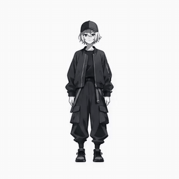
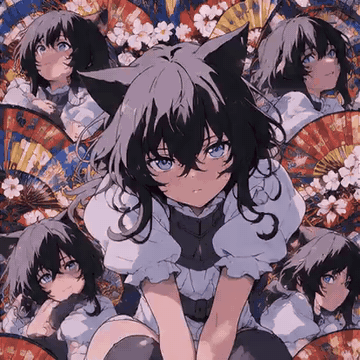
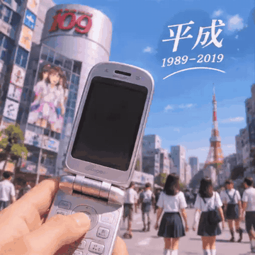
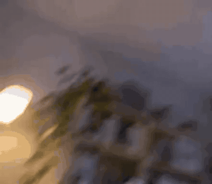
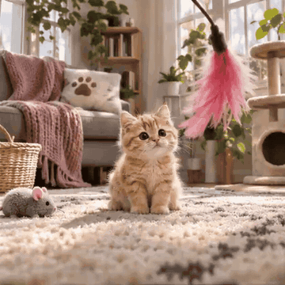
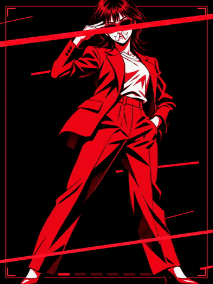
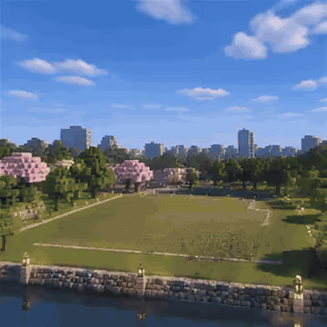
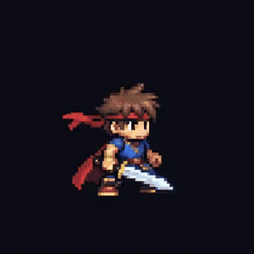
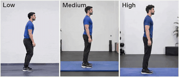
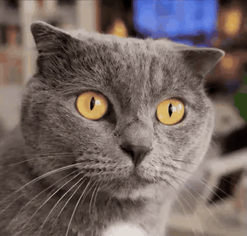

<div align="center">

<a href="https://apiko.app/zh/gpt-image-2-6-prompts?utm_source=github&utm_medium=banner&utm_campaign=awesome-gpt-image-2.6-prompts"></a>

[](../LICENSE)
[](../README_zh-CN.md#menu)
[](https://apiko.app/zh/models/gpt-image-2.6-flare?utm_source=github&utm_medium=badge&utm_campaign=awesome-gpt-image-2.6-prompts&utm_content=model_try)
[](https://apiko.app/zh/docs/api-manual/image-series/gpt-image-2.6-flare/images?utm_source=github&utm_medium=badge&utm_campaign=awesome-gpt-image-2.6-prompts&utm_content=docs)

[](gif-animation.md)
[](gif-animation_zh-CN.md)
[](gif-animation_zh-TW.md)
[](gif-animation_ko.md)

</div>

# 🔁 GIF 动图 · Awesome GPT Image 2.6 提示词

[← 返回 README](../README_zh-CN.md) · 本页共 38 条。提示词保持原文，未翻译。

> 短循环动画：写一个动作，最后回到起始姿势，镜头保持不动。

- [雪林提灯小猴循环动图](#gif-animation-01)
- [白宫外观 360° 无人机环绕](#gif-animation-02)
- [角色拉伸动作，扁平干净](#gif-animation-03)
- [单角色二次元万花筒循环](#gif-animation-04)
- [戴礼帽跳舞的青蛙「ego be gone!」](#gif-animation-05)
- [勤劳小蜜蜂每日打卡动图](#gif-animation-06)
- [线条小狗摇摆冒爱心](#gif-animation-07)
- [戴墨镜跳舞的猫](#gif-animation-08)
- [「平成」怀旧社交动图](#gif-animation-09)
- [参考图角色跳舞](#gif-animation-10)
- [角色 Q 版化做可爱动作](#gif-animation-11)
- [角色挥手微笑](#gif-animation-12)
- [让 AI 画自己误拍的自拍](#gif-animation-13)
- [骑自行车的鹈鹕](#gif-animation-14)
- [黏土小猫玩海洋球](#gif-animation-15)
- [迷幻背景里跳舞的猫](#gif-animation-16)
- [打哈欠的猫「晚安喵」](#gif-animation-17)
- [小橘猫扑向镜头](#gif-animation-18)
- [小说女主角的人物片段](#gif-animation-19)
- [转身对镜头眨眼的女生](#gif-animation-21)
- [K-pop 舞蹈动作](#gif-animation-22)
- [让人像照片动起来](#gif-animation-24)
- [一张图做成 MV 风动图](#gif-animation-25)
- [把视频剪成 GIF](#gif-animation-26)
- [冲咖啡的机器人](#gif-animation-27)
- [两行直播标题动图](#gif-animation-28)
- [物件猜成语：四件摆件轮流跳动](#gif-animation-29)
- [大阪城建造过程](#gif-animation-30)
- [水面上漂浮的纸船](#gif-animation-31)
- [纽约雪景水晶球](#gif-animation-32)
- [拉各斯街头跳非洲节拍舞的机器人](#gif-animation-33)
- [烧杯漩涡与鲁米诺发光](#gif-animation-34)
- [像素角色紫电击飞螺栓](#gif-animation-35)
- [像素勇者挥剑特效](#gif-animation-36)
- [按帧数尺寸规格做秋日人像动图](#gif-animation-37)
- [原地后空翻：三档复杂度](#gif-animation-38)
- [人体呼吸系统动态图解](#gif-animation-39)
- [猫咪眨眼，名字帽子掉到头上](#gif-animation-40)

<a id="gif-animation-01"></a>
### 1. 雪林提灯小猴循环动图

作者 [@OpenAI](https://developers.openai.com/api/docs/guides/image-prompting?model=gpt-image-2.6#generate-a-looping-gif) · 2 秒 · 1:1 · **[▶ 在 APIKO 运行](https://apiko.app/zh/gpt-image-2-6-prompts?utm_source=github&utm_medium=case&utm_campaign=awesome-gpt-image-2.6-prompts&utm_content=gif-animation-01#gif-animation-01)** · [原帖](https://developers.openai.com/api/docs/guides/image-prompting?model=gpt-image-2.6#generate-a-looping-gif)

<a href="https://apiko.app/zh/gpt-image-2-6-prompts?utm_source=github&utm_medium=case&utm_campaign=awesome-gpt-image-2.6-prompts&utm_content=gif-animation-01#gif-animation-01"></a>

**提示词:**

```text
A little monkey in an olive-green hooded coat stands in a snowy pine forest at dusk. A wooden cabin glows in the background. The monkey holds a glowing amber paper lantern at chest height, slowly lifts it, looks up and blinks, then lowers it back to its starting pose. Keep the lantern in its hands and the camera still. Make the motion loop smoothly.
```

<a id="gif-animation-02"></a>
### 2. 白宫外观 360° 无人机环绕

作者 [@nima2qisi2](https://x.com/nima2qisi2) · 2 秒 · 4:3 · **[▶ 在 APIKO 运行](https://apiko.app/zh/gpt-image-2-6-prompts?utm_source=github&utm_medium=case&utm_campaign=awesome-gpt-image-2.6-prompts&utm_content=gif-animation-02#gif-animation-02)** · [原帖](https://x.com/nima2qisi2/status/2118295936606798006)

<a href="https://apiko.app/zh/gpt-image-2-6-prompts?utm_source=github&utm_medium=case&utm_campaign=awesome-gpt-image-2.6-prompts&utm_content=gif-animation-02#gif-animation-02"></a>

**提示词:**

```text
【白宫外观】360°环绕
帮我做一个真实白宫外观的360°环绕模仿无人机拍摄，要真实还原建筑环境的实际外观情况，做成gif
```

<a id="gif-animation-03"></a>
### 3. 角色拉伸动作，扁平干净

作者 [@MiraMusic_AI](https://x.com/MiraMusic_AI) · 6 秒 · 1:1 · **[▶ 在 APIKO 运行](https://apiko.app/zh/gpt-image-2-6-prompts?utm_source=github&utm_medium=case&utm_campaign=awesome-gpt-image-2.6-prompts&utm_content=gif-animation-03#gif-animation-03)** · [原帖](https://x.com/MiraMusic_AI/status/2118168013618987298)

<a href="https://apiko.app/zh/gpt-image-2-6-prompts?utm_source=github&utm_medium=case&utm_campaign=awesome-gpt-image-2.6-prompts&utm_content=gif-animation-03#gif-animation-03"></a>

> 📎 这条需要你自己上传参考图。

**提示词:**

```text
ストレッチをしているGIFを製作してください。
仕上げはフラットでクリーンに。
複雑な微細テクスチャ、過剰な細密描写、粒状ノイズ、ザラつき、斜めグリッド状の模様なし
```

<a id="gif-animation-04"></a>
### 4. 单角色二次元万花筒循环

作者 [@aimikoda](https://x.com/aimikoda) · 2 秒 · 1:1 · **[▶ 在 APIKO 运行](https://apiko.app/zh/gpt-image-2-6-prompts?utm_source=github&utm_medium=case&utm_campaign=awesome-gpt-image-2.6-prompts&utm_content=gif-animation-04#gif-animation-04)** · [原帖](https://x.com/aimikoda/status/2118665755994546650)

<a href="https://apiko.app/zh/gpt-image-2-6-prompts?utm_source=github&utm_medium=case&utm_campaign=awesome-gpt-image-2.6-prompts&utm_content=gif-animation-04#gif-animation-04"></a>

> 📎 这条需要你自己上传参考图。

**提示词:**

```text
Create a seamless looping 1:1 2D anime kaleidoscope animation using the supplied character as the exact identity reference. Preserve the face, hairstyle, anatomy, outfit and visual style.

COMPOSITION: A vibrant, symmetrical kaleidoscope featuring one large central character and four surrounding copies arranged diagonally at different radial angles. Layer overlapping character portraits, decorative Japanese fans, floral motifs and colorful geometric patterns. Fill the entire frame with dense, intricate details extending beyond the edges. No circular frames.

ANIMATION: Keep the overall composition stationary while all five character instances perform independent, expressive anime movements: head tilts, blinking, playful expressions, flowing hair and rhythmic gestures. Use smooth hand-drawn animation with crisp linework, cel shading and lively secondary motion.

LOOP: All movements return naturally to their initial poses for a perfectly seamless infinite loop.

No text, logos, subtitles or additional characters.
```

<a id="gif-animation-05"></a>
### 5. 戴礼帽跳舞的青蛙「ego be gone!」

作者 [@princess414141](https://x.com/princess414141) · 2 秒 · 4:5 · **[▶ 在 APIKO 运行](https://apiko.app/zh/gpt-image-2-6-prompts?utm_source=github&utm_medium=case&utm_campaign=awesome-gpt-image-2.6-prompts&utm_content=gif-animation-05#gif-animation-05)** · [原帖](https://x.com/princess414141/status/2118144125354877152)

<a href="https://apiko.app/zh/gpt-image-2-6-prompts?utm_source=github&utm_medium=case&utm_campaign=awesome-gpt-image-2.6-prompts&utm_content=gif-animation-05#gif-animation-05"></a>

**提示词:**

```text
dancing frog with a top hat on, with ego be gone! written at the top
```

<a id="gif-animation-06"></a>
### 6. 勤劳小蜜蜂每日打卡动图

作者 [@MrGafish](https://x.com/MrGafish) · 2 秒 · 1:1 · **[▶ 在 APIKO 运行](https://apiko.app/zh/gpt-image-2-6-prompts?utm_source=github&utm_medium=case&utm_campaign=awesome-gpt-image-2.6-prompts&utm_content=gif-animation-06#gif-animation-06)** · [原帖](https://x.com/MrGafish/status/2118217749680025722)

<a href="https://apiko.app/zh/gpt-image-2-6-prompts?utm_source=github&utm_medium=case&utm_campaign=awesome-gpt-image-2.6-prompts&utm_content=gif-animation-06#gif-animation-06"></a>

**提示词:**

```text
生成一个GIF，用于在𝕏 平台每日签到打卡，寓意我是一个发贴的勤劳小蜜蜂
```

<a id="gif-animation-07"></a>
### 7. 线条小狗摇摆冒爱心

作者 [@CalosLaw](https://x.com/CalosLaw) · 1 秒 · 1:1 · **[▶ 在 APIKO 运行](https://apiko.app/zh/gpt-image-2-6-prompts?utm_source=github&utm_medium=case&utm_campaign=awesome-gpt-image-2.6-prompts&utm_content=gif-animation-07#gif-animation-07)** · [原帖](https://x.com/CalosLaw/status/2118199125707547102)

<a href="https://apiko.app/zh/gpt-image-2-6-prompts?utm_source=github&utm_medium=case&utm_campaign=awesome-gpt-image-2.6-prompts&utm_content=gif-animation-07#gif-animation-07"></a>

**提示词:**

```text
做一个线条小狗风格的循环 GIF 动图：一只白色圆滚滚的简笔画小狗，黑色粗线条，手绘涂鸦感，纯白背景。小狗开心地左右摇摆身体、摇尾巴，眼睛眯成弯弯的笑眼，头顶冒出一颗小爱心。画面简洁可爱，动作流畅，首尾无缝循环，正方形构图，适合做表情包。
```

<a id="gif-animation-08"></a>
### 8. 戴墨镜跳舞的猫

作者 [@SSSS_CRYPTOMAN](https://x.com/SSSS_CRYPTOMAN) · 1 秒 · 1:1 · **[▶ 在 APIKO 运行](https://apiko.app/zh/gpt-image-2-6-prompts?utm_source=github&utm_medium=case&utm_campaign=awesome-gpt-image-2.6-prompts&utm_content=gif-animation-08#gif-animation-08)** · [原帖](https://x.com/SSSS_CRYPTOMAN/status/2118144429848748108)

<a href="https://apiko.app/zh/gpt-image-2-6-prompts?utm_source=github&utm_medium=case&utm_campaign=awesome-gpt-image-2.6-prompts&utm_content=gif-animation-08#gif-animation-08"></a>

**提示词:**

```text
次の内容で GIF を作成して: サングラスをかけた猫がダンスをするミームっぽいGIF
```

<a id="gif-animation-09"></a>
### 9. 「平成」怀旧社交动图

作者 [@rem_rev](https://x.com/rem_rev) · 1 秒 · 1:1 · **[▶ 在 APIKO 运行](https://apiko.app/zh/gpt-image-2-6-prompts?utm_source=github&utm_medium=case&utm_campaign=awesome-gpt-image-2.6-prompts&utm_content=gif-animation-09#gif-animation-09)** · [原帖](https://x.com/rem_rev/status/2118252486360498485)

<a href="https://apiko.app/zh/gpt-image-2-6-prompts?utm_source=github&utm_medium=case&utm_campaign=awesome-gpt-image-2.6-prompts&utm_content=gif-animation-09#gif-animation-09"></a>

**提示词:**

```text
平成を象徴する何か。SNS向けのGIF画像を生成して下さい。
```

<a id="gif-animation-10"></a>
### 10. 参考图角色跳舞

作者 [@munou_ac](https://x.com/munou_ac) · 1 秒 · 3:4 · **[▶ 在 APIKO 运行](https://apiko.app/zh/gpt-image-2-6-prompts?utm_source=github&utm_medium=case&utm_campaign=awesome-gpt-image-2.6-prompts&utm_content=gif-animation-10#gif-animation-10)** · [原帖](https://x.com/munou_ac/status/2118220485150535796)

<a href="https://apiko.app/zh/gpt-image-2-6-prompts?utm_source=github&utm_medium=case&utm_campaign=awesome-gpt-image-2.6-prompts&utm_content=gif-animation-10#gif-animation-10"></a>

> 📎 这条需要你自己上传参考图。

**提示词:**

```text
参照画像のキャラクターが
ダンスするGIFを作ってください
```

<a id="gif-animation-11"></a>
### 11. 角色 Q 版化做可爱动作

作者 [@shinshin86](https://x.com/shinshin86) · 1 秒 · 1:1 · **[▶ 在 APIKO 运行](https://apiko.app/zh/gpt-image-2-6-prompts?utm_source=github&utm_medium=case&utm_campaign=awesome-gpt-image-2.6-prompts&utm_content=gif-animation-11#gif-animation-11)** · [原帖](https://x.com/shinshin86/status/2118225428976705908)

<a href="https://apiko.app/zh/gpt-image-2-6-prompts?utm_source=github&utm_medium=case&utm_campaign=awesome-gpt-image-2.6-prompts&utm_content=gif-animation-11#gif-animation-11"></a>

> 📎 这条需要你自己上传参考图。

**提示词:**

```text
このキャラクターをちびキャラ化して、何か可愛らしい動きをしているところをGIF画像にしてください。
```

<a id="gif-animation-12"></a>
### 12. 角色挥手微笑

作者 [@okan_aitool](https://x.com/okan_aitool) · 1 秒 · 1:1 · **[▶ 在 APIKO 运行](https://apiko.app/zh/gpt-image-2-6-prompts?utm_source=github&utm_medium=case&utm_campaign=awesome-gpt-image-2.6-prompts&utm_content=gif-animation-12#gif-animation-12)** · [原帖](https://x.com/okan_aitool/status/2118201578406772887)

<a href="https://apiko.app/zh/gpt-image-2-6-prompts?utm_source=github&utm_medium=case&utm_campaign=awesome-gpt-image-2.6-prompts&utm_content=gif-animation-12#gif-animation-12"></a>

> 📎 这条需要你自己上传参考图。

**提示词:**

```text
このキャラをGIFで動かして。手を振って笑う
```

<a id="gif-animation-13"></a>
### 13. 让 AI 画自己误拍的自拍

作者 [@nixus404](https://x.com/nixus404) · 1 秒 · 5:4 · **[▶ 在 APIKO 运行](https://apiko.app/zh/gpt-image-2-6-prompts?utm_source=github&utm_medium=case&utm_campaign=awesome-gpt-image-2.6-prompts&utm_content=gif-animation-13#gif-animation-13)** · [原帖](https://x.com/nixus404/status/2118180448840872167)

<a href="https://apiko.app/zh/gpt-image-2-6-prompts?utm_source=github&utm_medium=case&utm_campaign=awesome-gpt-image-2.6-prompts&utm_content=gif-animation-13#gif-animation-13"></a>

**提示词:**

```text
Create an animated GIF of yourself, as if you were taking an accidental selfie with your phone
```

<a id="gif-animation-14"></a>
### 14. 骑自行车的鹈鹕

作者 [@SSHCodes](https://x.com/SSHCodes) · 1 秒 · 1:1 · **[▶ 在 APIKO 运行](https://apiko.app/zh/gpt-image-2-6-prompts?utm_source=github&utm_medium=case&utm_campaign=awesome-gpt-image-2.6-prompts&utm_content=gif-animation-14#gif-animation-14)** · [原帖](https://x.com/SSHCodes/status/2118127375481504100)

<a href="https://apiko.app/zh/gpt-image-2-6-prompts?utm_source=github&utm_medium=case&utm_campaign=awesome-gpt-image-2.6-prompts&utm_content=gif-animation-14#gif-animation-14"></a>

**提示词:**

```text
generate a gif of a pelican riding a bicycle
```

<a id="gif-animation-15"></a>
### 15. 黏土小猫玩海洋球

作者 [@dreamwieber](https://x.com/dreamwieber) · 1 秒 · 1:1 · **[▶ 在 APIKO 运行](https://apiko.app/zh/gpt-image-2-6-prompts?utm_source=github&utm_medium=case&utm_campaign=awesome-gpt-image-2.6-prompts&utm_content=gif-animation-15#gif-animation-15)** · [原帖](https://x.com/dreamwieber/status/2118191599872344467)

<a href="https://apiko.app/zh/gpt-image-2-6-prompts?utm_source=github&utm_medium=case&utm_campaign=awesome-gpt-image-2.6-prompts&utm_content=gif-animation-15#gif-animation-15"></a>

**提示词:**

```text
generate an animated gif of a claymation kitten playing in a plastic ball pit
```

<a id="gif-animation-16"></a>
### 16. 迷幻背景里跳舞的猫

作者 [@xedrik7](https://x.com/xedrik7) · 1 秒 · 5:4 · **[▶ 在 APIKO 运行](https://apiko.app/zh/gpt-image-2-6-prompts?utm_source=github&utm_medium=case&utm_campaign=awesome-gpt-image-2.6-prompts&utm_content=gif-animation-16#gif-animation-16)** · [原帖](https://x.com/xedrik7/status/2118258491043483978)

<a href="https://apiko.app/zh/gpt-image-2-6-prompts?utm_source=github&utm_medium=case&utm_campaign=awesome-gpt-image-2.6-prompts&utm_content=gif-animation-16#gif-animation-16"></a>

**提示词:**

```text
psychedelic gif of cat dancing
```

<a id="gif-animation-17"></a>
### 17. 打哈欠的猫「晚安喵」

作者 [@eeseverlasting](https://x.com/eeseverlasting) · 2 秒 · 1:1 · **[▶ 在 APIKO 运行](https://apiko.app/zh/gpt-image-2-6-prompts?utm_source=github&utm_medium=case&utm_campaign=awesome-gpt-image-2.6-prompts&utm_content=gif-animation-17#gif-animation-17)** · [原帖](https://x.com/eeseverlasting/status/2118248165396848968)

<a href="https://apiko.app/zh/gpt-image-2-6-prompts?utm_source=github&utm_medium=case&utm_campaign=awesome-gpt-image-2.6-prompts&utm_content=gif-animation-17#gif-animation-17"></a>

> 📎 这条需要你自己上传参考图。

**提示词:**

```text
添付画像をつかって、おもしろいGIF『おやすみにゃ～！』をつくりたい。
```

<a id="gif-animation-18"></a>
### 18. 小橘猫扑向镜头

作者 [@meigesir](https://x.com/meigesir) · 2 秒 · 1:1 · **[▶ 在 APIKO 运行](https://apiko.app/zh/gpt-image-2-6-prompts?utm_source=github&utm_medium=case&utm_campaign=awesome-gpt-image-2.6-prompts&utm_content=gif-animation-18#gif-animation-18)** · [原帖](https://x.com/meigesir/status/2118248846648287720)

<a href="https://apiko.app/zh/gpt-image-2-6-prompts?utm_source=github&utm_medium=case&utm_campaign=awesome-gpt-image-2.6-prompts&utm_content=gif-animation-18#gif-animation-18"></a>

**提示词:**

```text
Animated 9-frame looping GIF. Fixed camera at floor level, bright cozy living room, warm soft daylight, cheerful mood. A tiny fluffy ginger kitten with big round sparkly eyes plays with a pink feather toy dangling just in front of the camera. Frames 1-2: kitten sits small in the center, wiggling, eyes locked on the feather. Frames 3-6: kitten hops playfully toward the camera, getting bigger each frame, mouth closed, ears perked, adorable curious face, one tiny paw reaching for the feather. Frame 7-8: kitten's soft pink paw pad gently boops the camera lens, kitten face cute and happy behind it. Frame 9: back to the kitten sitting small in the center, same as frame 1. Mouth closed in every frame, no teeth, no claws, cute and playful, never scary. Same kitten, same room, same lighting in every frame. Big, obvious motion. Photorealistic, sharp focus.
```

<a id="gif-animation-19"></a>
### 19. 小说女主角的人物片段

作者 [@MrGafish](https://x.com/MrGafish) · 2 秒 · 1:1 · **[▶ 在 APIKO 运行](https://apiko.app/zh/gpt-image-2-6-prompts?utm_source=github&utm_medium=case&utm_campaign=awesome-gpt-image-2.6-prompts&utm_content=gif-animation-19#gif-animation-19)** · [原帖](https://x.com/MrGafish/status/2118147815008518564)

<a href="https://apiko.app/zh/gpt-image-2-6-prompts?utm_source=github&utm_medium=case&utm_campaign=awesome-gpt-image-2.6-prompts&utm_content=gif-animation-19#gif-animation-19"></a>

**提示词:**

```text
创建一个 GIF，内容是下面小说中的人物片断

夏英杰皮肤白皙，身材修长，一张好看的脸上有一双令人为之倾倒的眼睛。她长发披肩，轻妆淡抹，身穿牛仔裤、运动鞋和一件挽起袖子的休闲衫，她的装束与她的青春美貌融合在一起，有一种看似不加修饰、实则高贵淡雅的气质美。尤其是她那双眼睛，沉静、自信之中似乎又包含着一缕淡淡的冷峻。
```

<a id="gif-animation-21"></a>
### 20. 转身对镜头眨眼的女生

作者 [@koe_ai414](https://x.com/koe_ai414) · 2 秒 · 1:1 · **[▶ 在 APIKO 运行](https://apiko.app/zh/gpt-image-2-6-prompts?utm_source=github&utm_medium=case&utm_campaign=awesome-gpt-image-2.6-prompts&utm_content=gif-animation-21#gif-animation-21)** · [原帖](https://x.com/koe_ai414/status/2118153765094351279)

<a href="https://apiko.app/zh/gpt-image-2-6-prompts?utm_source=github&utm_medium=case&utm_campaign=awesome-gpt-image-2.6-prompts&utm_content=gif-animation-21#gif-animation-21"></a>

**提示词:**

```text
日本人女性がくるっとターンして、カメラに向かってウィンクするGIF
```

<a id="gif-animation-22"></a>
### 21. K-pop 舞蹈动作

作者 [@shinya_blogger](https://x.com/shinya_blogger) · 1 秒 · 1:1 · **[▶ 在 APIKO 运行](https://apiko.app/zh/gpt-image-2-6-prompts?utm_source=github&utm_medium=case&utm_campaign=awesome-gpt-image-2.6-prompts&utm_content=gif-animation-22#gif-animation-22)** · [原帖](https://x.com/shinya_blogger/status/2118188465015890394)

<a href="https://apiko.app/zh/gpt-image-2-6-prompts?utm_source=github&utm_medium=case&utm_campaign=awesome-gpt-image-2.6-prompts&utm_content=gif-animation-22#gif-animation-22"></a>

**提示词:**

```text
ダンスするgifにして。正方形。
Medium shot, a cool female dancer executing sharp K-pop choreography, confident expression, striking poses, sleek modern outfit, high-energy dance performance,
```

<a id="gif-animation-24"></a>
### 22. 让人像照片动起来

作者 [@daifuku_ailover](https://x.com/daifuku_ailover) · 2 秒 · 5:4 · **[▶ 在 APIKO 运行](https://apiko.app/zh/gpt-image-2-6-prompts?utm_source=github&utm_medium=case&utm_campaign=awesome-gpt-image-2.6-prompts&utm_content=gif-animation-24#gif-animation-24)** · [原帖](https://x.com/daifuku_ailover/status/2118224031518454108)

<a href="https://apiko.app/zh/gpt-image-2-6-prompts?utm_source=github&utm_medium=case&utm_campaign=awesome-gpt-image-2.6-prompts&utm_content=gif-animation-24#gif-animation-24"></a>

> 📎 这条需要你自己上传参考图。

**提示词:**

```text
この画像でGIFアニメーション作って
```

<a id="gif-animation-25"></a>
### 23. 一张图做成 MV 风动图

作者 [@Ayu_AI_0912](https://x.com/Ayu_AI_0912) · 3 秒 · 3:4 · **[▶ 在 APIKO 运行](https://apiko.app/zh/gpt-image-2-6-prompts?utm_source=github&utm_medium=case&utm_campaign=awesome-gpt-image-2.6-prompts&utm_content=gif-animation-25#gif-animation-25)** · [原帖](https://x.com/Ayu_AI_0912/status/2118138025024839939)

<a href="https://apiko.app/zh/gpt-image-2-6-prompts?utm_source=github&utm_medium=case&utm_campaign=awesome-gpt-image-2.6-prompts&utm_content=gif-animation-25#gif-animation-25"></a>

> 📎 这条需要你自己上传参考图。

**提示词:**

```text
添付した画像を使ってかっこいいMV風のGIFアニメにして
```

<a id="gif-animation-26"></a>
### 24. 把视频剪成 GIF

作者 [@Ayu_AI_0912](https://x.com/Ayu_AI_0912) · 7 秒 · 16:9 · **[▶ 在 APIKO 运行](https://apiko.app/zh/gpt-image-2-6-prompts?utm_source=github&utm_medium=case&utm_campaign=awesome-gpt-image-2.6-prompts&utm_content=gif-animation-26#gif-animation-26)** · [原帖](https://x.com/Ayu_AI_0912/status/2118192179042750503)

<a href="https://apiko.app/zh/gpt-image-2-6-prompts?utm_source=github&utm_medium=case&utm_campaign=awesome-gpt-image-2.6-prompts&utm_content=gif-animation-26#gif-animation-26"></a>

> 📎 这条需要你自己上传参考图。

**提示词:**

```text
この動画をGIFアニメにして。生成する際は、GIFアニメっぽく場面をカットすること。
```

<a id="gif-animation-27"></a>
### 25. 冲咖啡的机器人

作者 [@sousoccer6](https://x.com/sousoccer6) · 2 秒 · 1:1 · **[▶ 在 APIKO 运行](https://apiko.app/zh/gpt-image-2-6-prompts?utm_source=github&utm_medium=case&utm_campaign=awesome-gpt-image-2.6-prompts&utm_content=gif-animation-27#gif-animation-27)** · [原帖](https://x.com/sousoccer6/status/2118210705585537226)

<a href="https://apiko.app/zh/gpt-image-2-6-prompts?utm_source=github&utm_medium=case&utm_campaign=awesome-gpt-image-2.6-prompts&utm_content=gif-animation-27#gif-animation-27"></a>

**提示词:**

```text
コーヒーを淹れるロボット
```

<a id="gif-animation-28"></a>
### 26. 两行直播标题动图

作者 [@iidaatcnt](https://x.com/iidaatcnt) · 2 秒 · 2:1 · **[▶ 在 APIKO 运行](https://apiko.app/zh/gpt-image-2-6-prompts?utm_source=github&utm_medium=case&utm_campaign=awesome-gpt-image-2.6-prompts&utm_content=gif-animation-28#gif-animation-28)** · [原帖](https://x.com/iidaatcnt/status/2118218668408746367)

<a href="https://apiko.app/zh/gpt-image-2-6-prompts?utm_source=github&utm_medium=case&utm_campaign=awesome-gpt-image-2.6-prompts&utm_content=gif-animation-28#gif-animation-28"></a>

**提示词:**

```text
“ChatGPT Images 2.6雑談 12：50まで”のGiFを作って！２行で！。
```

<a id="gif-animation-29"></a>
### 27. 物件猜成语：四件摆件轮流跳动

作者 [@GeekCatX](https://x.com/GeekCatX) · 3 秒 · 3:4 · **[▶ 在 APIKO 运行](https://apiko.app/zh/gpt-image-2-6-prompts?utm_source=github&utm_medium=case&utm_campaign=awesome-gpt-image-2.6-prompts&utm_content=gif-animation-29#gif-animation-29)** · [原帖](https://x.com/GeekCatX/status/2118160560290480519)

<a href="https://apiko.app/zh/gpt-image-2-6-prompts?utm_source=github&utm_medium=case&utm_campaign=awesome-gpt-image-2.6-prompts&utm_content=gif-animation-29#gif-animation-29"></a>

**提示词:**

```text
制作一个中国成语物件猜谜 GIF 动图，竖版 3:4，精致可爱的短视频封面风格。

【输出规格】
输出一个可播放的 GIF 动图。
画面尺寸：768×1024 像素。
总时长：3秒，无限循环。
建议帧率：20fps，约60帧。
动画包含4个连续动作段，每段0.75秒，分别对应四件物品。
全程为同一个完整画面，镜头固定，构图固定，没有切镜、推拉、摇移或缩放。
【制作原则：同一母版，局部动画】
先建立一张完整的静态母版，再基于同一母版制作动画。
所有帧保持相同的背景、构图、文字、台面、物件造型、材质、颜色与光照。
只允许当前指定物件进行小幅竖直位移，并同步调整它的局部高光、接触阴影与倒影。
其余三个物件保持静止。
文字必须使用同一份静态图层，在全部帧中重复使用，不要逐帧重新绘制。
【背景】
深蓝色专业摄影棚背景，中心为柔和宝蓝色，向四周自然渐暗为午夜蓝。
背景纯净，具有轻微柔光晕，渐变细腻，没有明显纹理和杂乱装饰。
背景空白区域分布3—5个微小、低亮度的金色光点。
光点沿非常短的闭合轨迹缓慢漂浮，一个循环周期为3秒。
光点不穿过文字或物件，不闪烁、不突然出现或消失，循环结束时回到起始位置。
【文字：全程完全静止】
画面中只允许出现以下两行文字，不增加任何其他文字：
第一行：
物件藏着一个成语

第二行：
你猜出来了吗
第一行位于画面顶部居中，使用明黄色 #FFD54A 的超粗圆体大字，字形饱满圆润，带浅描边和轻微投影。
第二行位于第一行正下方，使用白色粗圆体，字号约为第一行的60%。

两行文字保持足够行距，四周预留安全边距，不贴边、不裁切。
汉字笔画完整，字形标准，清晰易读，无错别字。
在所有帧中，文字的位置、字号、字距、笔画、颜色、描边、阴影与透明度完全一致。
文字不参与弹跳、高光扫动、闪烁或任何其他动画。
【台面与构图】
画面中下部是一条横向浅木纹展示台。
台面干净，木纹细腻，具有柔和、克制的反光。
四件物品集中排列于画面中下部，物件组占画面宽度约85%—90%。
四件物品位于同一前后层级，静止时底部对齐于同一条台面接触基线。
它们具有接近的视觉体量，间距均匀，彼此留出清晰空隙。
不前后错落、不堆叠、不互相遮挡。

采用固定的轻微俯视角度，能够清楚看见杯口和水面，同时保持四件物品横向并排的秩序感。
【四件物品：顺序固定】
从左到右严格依次为：
一辆红色Q版小汽车。
圆润饱满，车身呈中国红，轮子与车窗清晰可辨，具有精致陶瓷玩具质感。

一个装满清水的青花瓷杯。
杯身具有细腻青花纹样，杯口清晰，能够看见透明清水与柔和水面反光。
杯身无文字，水面保持平稳，不溢出、不飞溅。
一匹金色Q版小马。
造型圆润可爱，具有清晰的马头、鬃毛、四肢与尾巴，表面为温润的金色陶瓷釉面。
一条青绿色盘身小龙。
中国传统小龙造型，身体盘曲，龙头微微抬起，龙角、龙须与鳞片适度简化，神态可爱，具有青绿色陶瓷釉面质感。

四件物品保持各自明确的识别特征。
物件表面没有文字、拼音、标签、数字或答案提示。
【动作规则】
所有物件均为刚性的陶瓷摆件，只允许整体轻轻向上移动，再回到原位。
不挤压、不拉伸、不旋转、不左右移动、不改变造型。

弹跳最高点距离原位约为画面高度的1%，动作轻巧、克制。
每个物件必须完整落回原位后，下一个物件才开始动作。
任意时刻，四件物品中最多只有一件正在运动。
当前物件弹起时，一道低强度、柔和的高光缓缓掠过其表面。
高光只作用于当前物件，不影响文字、背景和其他物件。
物件下方的阴影与倒影随高度轻微变化，落地后恢复母版状态。
小汽车轮子不转，小马不迈腿，小龙不摆尾、不转头。

【3秒动作时间线】
0.00—0.75秒：
红色小汽车完成一次轻轻弹起并落回原位。
瓷杯、小马、小龙保持静止。
0.75—1.50秒：
青花瓷杯完成一次轻轻弹起并落回原位。
汽车、小马、小龙保持静止。

1.50—2.25秒：
金色小马完成一次轻轻弹起并落回原位。
汽车、瓷杯、小龙保持静止。
2.25—3.00秒：
青绿色小龙完成一次轻轻弹起并落回原位。
汽车、瓷杯、小马保持静止。

每个0.75秒动作段均遵循：
短暂停住 → 平缓上升 → 平缓落下 → 落定后短暂停住。
上升和下落采用柔和缓入缓出，不突然跳位，不夸张弹震。

【无缝循环】
首帧与末帧完全一致：
四件物品全部落在原位，所有高光、阴影、倒影与背景光点均回到初始状态。
从末帧接回首帧时，没有位置跳变、亮度跳变或颜色闪动。
循环中不出现黑帧、白帧、残影或重影。

【整体质感】
精致可爱的Q版3D陶瓷摆件，圆润、细腻、通透。
以中国红、金色、青绿色和青花蓝点缀深蓝背景，融入克制的中国传统纹样细节。
顶部柔光配合左右轮廓光，物件边缘高光清晰，台面倒影柔和。
整体具有中国文化韵味，适合全年龄观看。
【禁止事项】
不出现成语答案。
不出现额外文字、水印、品牌标志或界面元素。
不出现分镜拼图、四宫格或多画面。
不改变四件物品的数量、顺序、造型、颜色或比例。
不让两个物件同时运动。
不让物件重叠、碰撞、堆叠或横向移位。
不让文字闪烁、变形、位移或重新生成。
不改变相机位置、背景亮度或整体色调。
```

<a id="gif-animation-30"></a>
### 28. 大阪城建造过程

作者 [@jammaru_lab](https://x.com/jammaru_lab) · 1 秒 · 1:1 · **[▶ 在 APIKO 运行](https://apiko.app/zh/gpt-image-2-6-prompts?utm_source=github&utm_medium=case&utm_campaign=awesome-gpt-image-2.6-prompts&utm_content=gif-animation-30#gif-animation-30)** · [原帖](https://x.com/jammaru_lab/status/2118153279821787623)

<a href="https://apiko.app/zh/gpt-image-2-6-prompts?utm_source=github&utm_medium=case&utm_campaign=awesome-gpt-image-2.6-prompts&utm_content=gif-animation-30#gif-animation-30"></a>

**提示词:**

```text
大阪城を建築する流れをGIFにして
```

<a id="gif-animation-31"></a>
### 29. 水面上漂浮的纸船

作者 [@thinkszyg](https://x.com/thinkszyg) · 1 秒 · 1:1 · **[▶ 在 APIKO 运行](https://apiko.app/zh/gpt-image-2-6-prompts?utm_source=github&utm_medium=case&utm_campaign=awesome-gpt-image-2.6-prompts&utm_content=gif-animation-31#gif-animation-31)** · [原帖](https://x.com/thinkszyg/status/2118166234495947044)

<a href="https://apiko.app/zh/gpt-image-2-6-prompts?utm_source=github&utm_medium=case&utm_campaign=awesome-gpt-image-2.6-prompts&utm_content=gif-animation-31#gif-animation-31"></a>

**提示词:**

```text
Make a looping GIF of a paper boat bobbing on the water.
```

<a id="gif-animation-32"></a>
### 30. 纽约雪景水晶球

作者 [@dreamwieber](https://x.com/dreamwieber) · 1 秒 · 1:1 · **[▶ 在 APIKO 运行](https://apiko.app/zh/gpt-image-2-6-prompts?utm_source=github&utm_medium=case&utm_campaign=awesome-gpt-image-2.6-prompts&utm_content=gif-animation-32#gif-animation-32)** · [原帖](https://x.com/dreamwieber/status/2118190877567037732)

<a href="https://apiko.app/zh/gpt-image-2-6-prompts?utm_source=github&utm_medium=case&utm_campaign=awesome-gpt-image-2.6-prompts&utm_content=gif-animation-32#gif-animation-32"></a>

**提示词:**

```text
generate an animated gif of a beautiful NYC snow globe
```

<a id="gif-animation-33"></a>
### 31. 拉各斯街头跳非洲节拍舞的机器人

作者 [@o_adeeko](https://x.com/o_adeeko) · 1 秒 · 1:1 · **[▶ 在 APIKO 运行](https://apiko.app/zh/gpt-image-2-6-prompts?utm_source=github&utm_medium=case&utm_campaign=awesome-gpt-image-2.6-prompts&utm_content=gif-animation-33#gif-animation-33)** · [原帖](https://x.com/o_adeeko/status/2118203950306410729)

<a href="https://apiko.app/zh/gpt-image-2-6-prompts?utm_source=github&utm_medium=case&utm_campaign=awesome-gpt-image-2.6-prompts&utm_content=gif-animation-33#gif-animation-33"></a>

**提示词:**

```text
Create an animated GIF of a robot dancing to Afrobeats on a busy Lagos street. Make the movement loop smoothly.
```

<a id="gif-animation-34"></a>
### 32. 烧杯漩涡与鲁米诺发光

作者 [@ZHENGJUNTING92](https://x.com/ZHENGJUNTING92) · 1 秒 · 1:1 · **[▶ 在 APIKO 运行](https://apiko.app/zh/gpt-image-2-6-prompts?utm_source=github&utm_medium=case&utm_campaign=awesome-gpt-image-2.6-prompts&utm_content=gif-animation-34#gif-animation-34)** · [原帖](https://x.com/ZHENGJUNTING92/status/2118252052556255364)

<a href="https://apiko.app/zh/gpt-image-2-6-prompts?utm_source=github&utm_medium=case&utm_campaign=awesome-gpt-image-2.6-prompts&utm_content=gif-animation-34#gif-animation-34"></a>

**提示词:**

```text
制作gif
垂直俯拍一个烧杯的杯口，里面的水在旋转形成漩涡，然后滴入液体
C8H7N3O2+H202+NaOH-Na2C8H5N204+N2 1+H20+luminol CL
烧杯中是少量罗丹明B碱性的鲁米诺溶液 和过氧化氢
胶头滴管中是含铁离子溶液 和荧光染料
```

<a id="gif-animation-35"></a>
### 33. 像素角色紫电击飞螺栓

作者 [@YaReYaRu30Life](https://x.com/YaReYaRu30Life) · 1 秒 · 1:1 · **[▶ 在 APIKO 运行](https://apiko.app/zh/gpt-image-2-6-prompts?utm_source=github&utm_medium=case&utm_campaign=awesome-gpt-image-2.6-prompts&utm_content=gif-animation-35#gif-animation-35)** · [原帖](https://x.com/YaReYaRu30Life/status/2118167174053597233)

<a href="https://apiko.app/zh/gpt-image-2-6-prompts?utm_source=github&utm_medium=case&utm_campaign=awesome-gpt-image-2.6-prompts&utm_content=gif-animation-35#gif-animation-35"></a>

> 📎 这条需要你自己上传参考图。

**提示词:**

```text
このキャラをドット化して、紫の電光エフェクトでボルトをナットを吹き飛ばすGIFを作成
```

<a id="gif-animation-36"></a>
### 34. 像素勇者挥剑特效

作者 [@YaReYaRu30Life](https://x.com/YaReYaRu30Life) · 1 秒 · 1:1 · **[▶ 在 APIKO 运行](https://apiko.app/zh/gpt-image-2-6-prompts?utm_source=github&utm_medium=case&utm_campaign=awesome-gpt-image-2.6-prompts&utm_content=gif-animation-36#gif-animation-36)** · [原帖](https://x.com/YaReYaRu30Life/status/2118166505603153922)

<a href="https://apiko.app/zh/gpt-image-2-6-prompts?utm_source=github&utm_medium=case&utm_campaign=awesome-gpt-image-2.6-prompts&utm_content=gif-animation-36#gif-animation-36"></a>

**提示词:**

```text
GIFを作成。ドット絵の勇者。
剣にエフェクトをつけて振り回す
```

<a id="gif-animation-37"></a>
### 35. 按帧数尺寸规格做秋日人像动图

作者 [@mirai_ai2050](https://x.com/mirai_ai2050) · 3 秒 · 1:1 · **[▶ 在 APIKO 运行](https://apiko.app/zh/gpt-image-2-6-prompts?utm_source=github&utm_medium=case&utm_campaign=awesome-gpt-image-2.6-prompts&utm_content=gif-animation-37#gif-animation-37)** · [原帖](https://x.com/mirai_ai2050/status/2118213713761292432)

<a href="https://apiko.app/zh/gpt-image-2-6-prompts?utm_source=github&utm_medium=case&utm_campaign=awesome-gpt-image-2.6-prompts&utm_content=gif-animation-37#gif-animation-37"></a>

> 📎 这条需要你自己上传参考图。

**提示词:**

```text
添付画像を基準に、アニメーションGIFファイルを生成してください。

【出力仕様】
・各フレームの幅：288px
・各フレームの高さ：512px
・総フレーム数：16フレーム
・各フレームの表示時間：200ミリ秒
・合計再生時間：3.2秒
・無限ループ
・この寸法をGIFファイルそのもののピクセル寸法として使用する。表示上のサイズだけを変えたり、余白を追加して寸法を合わせたりしない。

【映像内容】
参考画像と同じミライ、同じ顔、短いボブ、衣装、秋の街並み、日差しを維持する。

構図は胸から上。顔全体と頭の上が入り、右手に持った赤いモミジが胸元に見える。
カメラ固定、ワンカット。

ミライがカメラを見ながら口元を少しほころばせ、一度だけ自然に瞬きをする。
風でボブの毛先と背景の紅葉が少し揺れる。
最後は最初の表情と姿勢へ戻り、自然につながるループにする。

全フレームを同じ人物の連続動作として描く。
フレームを単純に複製して枚数だけを増やさず、毛先や背景の葉の動きを時間に沿って少しずつ変える。
顔立ちや衣装を途中で変更しない。

静止画、分割画像、絵コンテではなく、動くGIFを出力する。
字幕、文字、ロゴ、透かし、音楽なし。
```

<a id="gif-animation-38"></a>
### 36. 原地后空翻：三档复杂度

作者 [@gabrielchua](https://x.com/gabrielchua) · 6 秒 · 21:9 · **[▶ 在 APIKO 运行](https://apiko.app/zh/gpt-image-2-6-prompts?utm_source=github&utm_medium=case&utm_campaign=awesome-gpt-image-2.6-prompts&utm_content=gif-animation-38#gif-animation-38)** · [原帖](https://x.com/gabrielchua/status/2118135343354720648)

<a href="https://apiko.app/zh/gpt-image-2-6-prompts?utm_source=github&utm_medium=case&utm_campaign=awesome-gpt-image-2.6-prompts&utm_content=gif-animation-38#gif-animation-38"></a>

**提示词:**

```text
create a GIF of a man doing a standing backflip
```

<a id="gif-animation-39"></a>
### 37. 人体呼吸系统动态图解

作者 [@MercyDeGreat](https://x.com/MercyDeGreat) · 3 秒 · 1:1 · **[▶ 在 APIKO 运行](https://apiko.app/zh/gpt-image-2-6-prompts?utm_source=github&utm_medium=case&utm_campaign=awesome-gpt-image-2.6-prompts&utm_content=gif-animation-39#gif-animation-39)** · [原帖](https://x.com/MercyDeGreat/status/2118319217611055417)

<a href="https://apiko.app/zh/gpt-image-2-6-prompts?utm_source=github&utm_medium=case&utm_campaign=awesome-gpt-image-2.6-prompts&utm_content=gif-animation-39#gif-animation-39"></a>

**提示词:**

```text
Create an educational animated GIF explaining how the human respiratory system moves air and exchanges gases. Show the nasal cavity, pharynx, larynx, trachea, bronchi, bronchioles, and lungs with clearly visible alveoli clusters. Animate a continuous airflow path from the nose/mouth downward through the airways into the alveoli, followed by oxygen entering the blood and carbon dioxide returning, then reverse the flow for exhalation. Keep all anatomical structures and connecting pathways in fixed positions. Use clean scientific visualization, a dark background, and a seamless loop. This is a conceptual illustration, not a simulation of real physiology or gas diffusion rates.
```

<a id="gif-animation-40"></a>
### 38. 猫咪眨眼，名字帽子掉到头上

作者 [@ozansihay](https://x.com/ozansihay) · 2 秒 · 1:1 · **[▶ 在 APIKO 运行](https://apiko.app/zh/gpt-image-2-6-prompts?utm_source=github&utm_medium=case&utm_campaign=awesome-gpt-image-2.6-prompts&utm_content=gif-animation-40#gif-animation-40)** · [原帖](https://x.com/ozansihay/status/2118238946412953985)

<a href="https://apiko.app/zh/gpt-image-2-6-prompts?utm_source=github&utm_medium=case&utm_campaign=awesome-gpt-image-2.6-prompts&utm_content=gif-animation-40#gif-animation-40"></a>

> 📎 这条需要你自己上传参考图。

**提示词:**

```text
Kedimiz Robin’in GIF'ini oluştur. Kameraya baksın göz tek gözünü kırpsın ve kafasına Robin yazan bir şapka düşsün.
```

[← 返回 README](../README_zh-CN.md)
